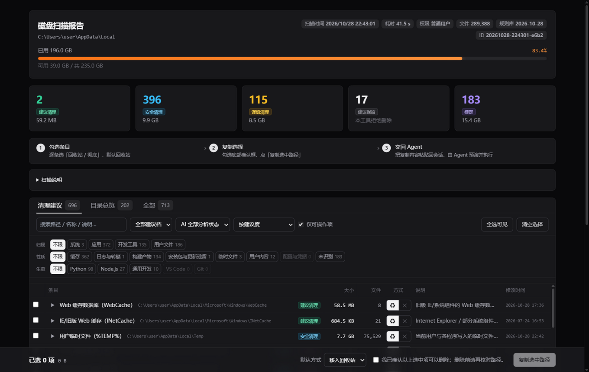
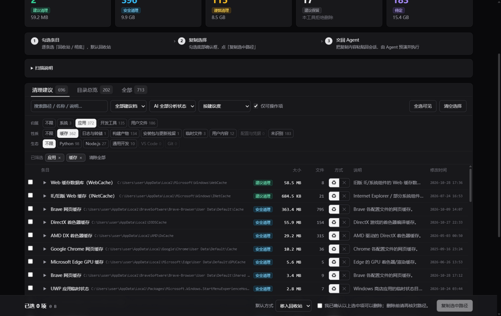
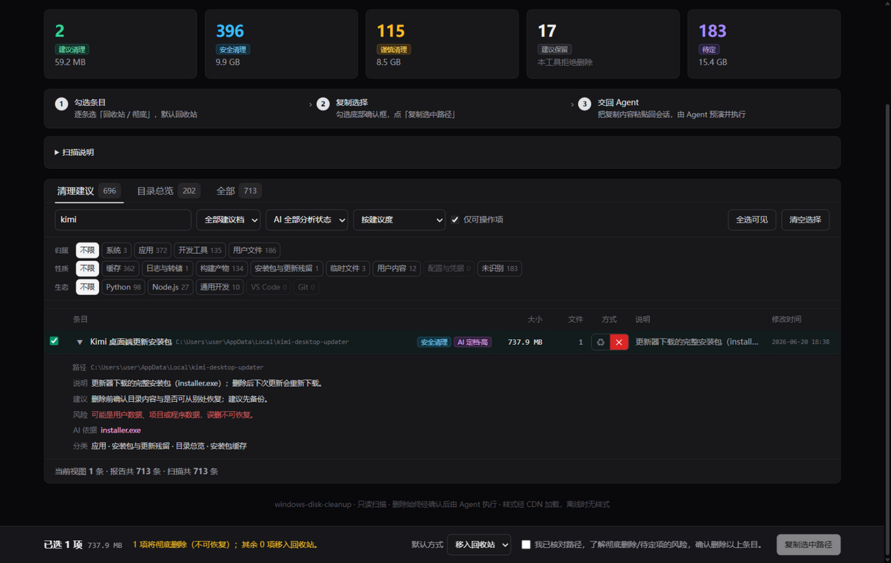

# windows-disk-cleanup

给 Windows 做一次**看得见、可反悔、有账可查**的磁盘清理。

它不接管删除，也不替你判断。流程是：只读扫描 → 生成一份可勾选的离线报告 → 你选完把选择交回来 → Agent 逐条核对后再动手 → 生成清理报告。扫描不删任何东西，报告页也没有删除按钮——删什么、怎么删，决定权始终在你手里。

适合「C 盘满了但不知道该删什么」：226 条规则认识系统升级残留、更新缓存、浏览器与开发工具缓存、项目构建产物；不认识的东西会老实标成「待定」，必要时由 AI 在只读范围内补充说明。

## 效果预览

以下截图取自一次真实扫描（`C:\Users\<user>\AppData\Local`，713 条条目），路径已脱敏。

**报告概览**：磁盘使用率进度条按档位着色（≥80% 橙色告警），五张建议档统计卡，三步使用流程。



**三维分类筛选**：归属 / 性质 / 生态各占一行，计数互不影响、不会随筛选跳动；生效中的筛选以可移除标签列出。



**条目详情与逐条删除方式**：AI 高置信判定把「待定」提升为「安全清理」（AI 定档徽章）；展开可见路径、说明、建议、风险、AI 依据；每行可单独选「回收站 / 彻底删除」，选中后底部提示不可恢复并要求确认。



## 何时触发

- C 盘或某个盘满了，想知道空间被什么占了，再决定删什么
- 想清理缓存、更新残留、旧项目构建产物，但需要先看清单
- 希望删除可审计：删了什么、释放多少、哪些失败，都能查到
- 英文说法如 "clean up C drive" / "disk cleanup report" / "free up disk space"

不适用：只想分析单个文件、希望你直接删除给定路径、非 Windows，或要做分区/格式化/系统重装/驱动管理。

## 你会经历什么

1. 你说明目标（哪个盘、哪个目录）。
2. 它先确认环境（是否管理员、有没有 PowerShell），然后只读扫描，给你本地报告链接和一句话摘要。
3. 你在报告里勾选条目，逐条选「回收站」或「彻底删除」（默认回收站），勾确认框，点「复制选中路径」。
4. 把复制内容粘贴回来。它先做一次预演：无效路径、被父目录覆盖的条目、需要管理员或需要二次确认的部分都会列出来；确认无误才执行。
5. 你拿到清理报告：逐项状态、处理量、磁盘可用空间的实际变化、失败原因。

全程不用记命令、不用改文件。你粘贴的选择只包含路径与删除方式，且路径必须来自本次扫描——手工加进去的会被拒绝。

## 它认得出什么

| 归属 | 典型对象 |
| --- | --- |
| 系统 | 升级残留（Windows.old、$Windows.~BT 等）、Windows 更新下载缓存、系统临时文件、日志与转储、回收站 |
| 应用 | 浏览器缓存与配置、各类应用缓存、安装包与更新残留、网盘同步缓存 |
| 开发工具 | 包管理器缓存（npm/pnpm/yarn/pip/uv/cargo/go/nuget/gradle/maven）、构建产物（node_modules/.venv/dist/target…）、编辑器缓存、AI 模型缓存 |
| 用户文件 | 下载、临时文件、各类文档目录 |

每条给出五档建议之一：**建议清理 / 安全清理 / 谨慎清理 / 建议保留 / 待定**。标「建议保留」的它拒绝删除；「待定」是没命中规则的目录，需要你判断，或由 AI 只读探索后补充说明（AI 补充的内容单独标注，且不能放宽可删范围）。

规则库是纯数据、可读可审，明细与官方来源见 [references/rules-catalog.md](references/rules-catalog.md)。

## 安全承诺

- **扫描只读**；报告页没有任何删除按钮，删除只由 Agent 在你明确选择后执行。
- **逐条核对**：路径必须在本次扫描结果内、未被标记保留、不在系统保护清单里、不是符号链接。
- **保护清单独立于扫描规则**：即使有人手工改扫描结果，系统目录、程序安装目录、凭据目录、用户配置根目录仍会被拒绝。
- **父子重叠只删父目录**；符号链接只删链接本身，不进入目标。
- **失败如实报告**：被占用、权限不足、路径过长都会记录原因，不会为了"成功"删父目录、停服务或改权限。
- **默认回收站**；彻底删除不可恢复，报告与确认环节都会明确警告。

## 边界

- 仅支持 Windows 10/11。
- 不做分区、格式化、系统重装、驱动管理、注册表清理、碎片整理。
- 不接管系统自带工具（磁盘清理 / DISM / Storage Sense）——只给建议，不替你运行。
- 不保证释放量：硬链接、压缩、稀疏文件、被占用文件都会让实际可用空间小于清单显示的大小。

## 安装

把这句交给你的 Agent（它会自己安装并验证）：

```text
安装 GitHub 仓库 GitZhiQing/agent-skills 里的 windows-disk-cleanup skill：优先 `npx skills add "GitZhiQing/agent-skills/windows-disk-cleanup"`；不可用则 clone 仓库后执行 `bash scripts/skills-link.sh windows-disk-cleanup`，再用 `scripts/skills-doctor.sh` 验证并汇报结果。
```

插件市场与手动分发方式见[仓库 README](../../README.md#安装)。

运行条件：Windows 10/11 + Python 3.9+（纯标准库）；回收站模式需 Windows PowerShell 5.1+；系统级目录通常需要管理员权限。

## 想深入看

- [SKILL.md](SKILL.md) — Agent 的固定工作流与硬规则（权威来源）
- [references/protocol.md](references/protocol.md) — 选择协议、二次校验、保护清单、失败处理
- [references/rules-catalog.md](references/rules-catalog.md) — 规则分类、226 条明细与官方来源
- [references/enrichment-protocol.md](references/enrichment-protocol.md) — AI 补充说明的范围、预算与边界
- [memory/INDEX.md](memory/INDEX.md) — 跨会话积累的经验索引
- [docs/TESTS.md](docs/TESTS.md) — 行为协议回归
- [docs/SPEC.md](docs/SPEC.md) — 架构、安全模型与设计决策

许可：MIT（仓库根 [LICENSE](../../LICENSE)）。
